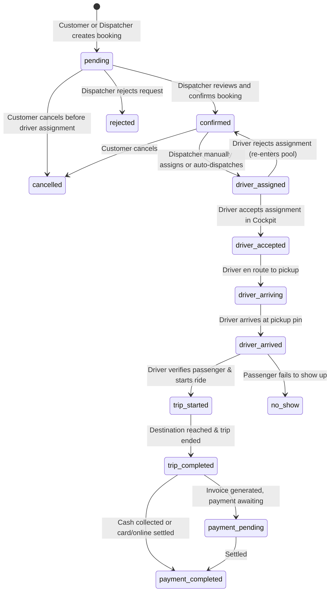

# Booking & Dispatch Lifecycle

## 1. Booking Status State Machine

The booking lifecycle supports both on-demand ("immediate") taxi hail and "scheduled" intercity / pilgrimage bookings.



### Transition Guard Rules

In `AppContext.tsx`, strict transition protections are enforced:
1. **Cancelled rides**: Once `status === 'cancelled'`, the booking cannot be restarted or moved to active statuses.
2. **Completed rides**: Once `status === 'trip_completed'`, the ride cannot be reverted to `trip_started`.
3. **Trip cancellation lock**: A ride cannot be cancelled by customer or dispatcher once `trip_started` or `trip_completed`.

---

## 2. Fare Calculation Engine (`src/lib/fare-calculator.ts`)

Every ride's estimated fare is computed deterministically using vehicle-type specific rate cards:

### Base Parameters

| Vehicle Type | Key | Base Fare (SAR) | Per Km Rate (SAR) | Per Min Rate (SAR) | Min Fare (SAR) | Waiting Rate/min | Cancellation Fee | Capacity |
| :--- | :--- | :--- | :--- | :--- | :--- | :--- | :--- | :--- |
| **Executive Sedan** | `sedan` | 25.0 | 3.5 | 0.50 | 35.0 | 1.0 | 20.0 | 4 Pax |
| **Family SUV** | `suv` | 45.0 | 5.0 | 0.75 | 60.0 | 1.5 | 30.0 | 7 Pax |
| **VIP GMC Yukon** | `vip_gmc` | 90.0 | 8.5 | 1.50 | 120.0 | 2.5 | 50.0 | 7 Pax |
| **Royal Van** | `van` | 70.0 | 7.0 | 1.20 | 95.0 | 2.0 | 40.0 | 11 Pax |
| **Pilgrim Bus** | `bus` | 150.0 | 12.0 | 2.00 | 200.0 | 4.0 | 80.0 | 49 Pax |

### Calculation Formula

```typescript
const baseFare = rule.base_fare;
const distanceCharge = distanceKm * rule.per_km_rate;
const timeCharge = durationMin * rule.per_minute_rate;
const rawSubtotal = baseFare + distanceCharge + timeCharge;
const finalTotal = Math.max(rawSubtotal, rule.minimum_fare);
```

### Additional Charges (`AdditionalCharge`)
Drivers can record auxiliary fees on active rides:
- `toll`: Highway tolls (e.g., Jeddah Airport Express Toll)
- `waiting`: Waiting time beyond courtesy window
- `extra_luggage`: Bulky baggage or luggage assistance
- `parking`: Terminal or hotel parking pass
- `special_service`: Wheelchair ramp, baby seat, extra stop

---

## 3. Dispatch Workflows

### Manual Dispatch
1. Dispatcher navigates to `/dispatcher/queue`.
2. Inspects pending or confirmed booking details (pickup, drop-off, vehicle type requested, passenger count, notes).
3. Clicks **Assign Driver** modal.
4. System filters eligible drivers based on matching `assigned_vehicle.vehicle_type` and `status === 'available'`.
5. Dispatcher selects driver. Booking status transitions to `driver_assigned`.
6. Driver receives a high-priority notification with trip route and customer notes.

### Auto-Dispatch
- `autoAssignDriver(bookingId)` in `AppContext.tsx` automatically finds the first `available` driver with a matching vehicle type.
- If none match the exact vehicle, it falls back to any available driver, or notifies the dispatcher if fleet capacity is exhausted.
